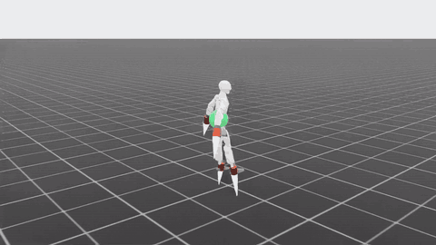

# Humanoid_fly: teaching a humanoid robot to fly with thrusters (Isaac Lab 3.0 + PPO)



A Unitree R1 humanoid (29 kg, 26 joints) learns to take off, fly to 3D waypoints and hover, trained with
reinforcement learning (PPO, 4096 parallel simulations on one GPU). Two variants:

- **Iron Man**: thrusters fixed in the boots and gloves, no gimbals. The policy controls 4 throttles + 24 joints and
  steers only by pointing its feet and swinging its arms. ([full tour video](media/ironman_final_tour.mp4))
- **Jet pack**: two gimballed boosters on the back. ([demo video](media/jet_booster_demo.mp4))

| task | crashes | waypoints reached | hold error | notes |
|---|---|---|---|---|
| Iron Man (final) | 0 / 256 | 100 % | 1.4 cm | faces each goal within 2 deg while holding |
| Jet pack (final) | 0 / 256 | 100 % | 1.3 cm | flies leaning forward (~28 deg mean tilt) |

Each eval: 256 robots fly the same 7-waypoint tour from a standing take-off (1.5-3.5 m altitude, 4 s per waypoint).
How it was built, what went wrong and the lessons: [notes/NOTES.md](notes/NOTES.md) (both variants, Iron Man detail)
and [notes/JET_BOOSTERS.md](notes/JET_BOOSTERS.md) (jet design, run-by-run history, open issues).
Training progression videos: [iter 200](media/ironman_progress_1_iter200.mp4),
[iter 800](media/ironman_progress_2_iter800.mp4), [with heading command](media/ironman_progress_3_heading_iter500.mp4).
Best policies with their exact configs: `checkpoints/`. Short training clips: `media/training_clips/`.

## Jet pack
The R1 (29 kg) gets two gimballed jet boosters on the back of its torso and learns to fly to 3D waypoints with PPO.

### Tasks
| id | actions | notes |
|---|---|---|
| `Humanoid-Fly-R1-Jet-v0` | 6: throttle L/R, gimbal pitch L/R, gimbal roll L/R | body held in its default pose by PD |
| `Humanoid-Fly-R1-Jet-Smooth-v0` | 6 | stage 2 (`--resume`), smoother; final policy `checkpoints/jet/model_1499.pt` |
| `Humanoid-Fly-R1-Jet-WholeBody-v0` | 6 + 24 joint offsets | policy also moves arms/legs/waist |

Boosters: total thrust-to-weight 2.0 (284 N each), ±25° gimbal, 80 ms spool lag. They're simulated as a force + torque
on `waist_yaw_link`; their casings and flames are drawn as visual markers only, so they add no mass and have no collisions.
Half the episodes start standing on the ground (take-off), half start mid-air with random tilt/velocity (recovery).
A new goal every 6 s; episodes are 12 s long. Tune everything in `humanoid_fly/tasks/r1_jet/r1_jet_env_cfg.py`.

## Iron Man (thrusters in the boots and gloves)
| id | notes |
|---|---|
| `Humanoid-Fly-R1-IronMan-v0` | 4 throttles + 24 joint offsets, fly to 3D goals, yaw free |
| `Humanoid-Fly-R1-IronMan-v1` | same, plus a heading command: face the next goal (sin/cos of the yaw error observed) |
| `Humanoid-Fly-R1-IronMan-Smooth-v0` / `-Smooth-v1` | stage 2 (`--resume` a stage-1 checkpoint): stronger upright/ang-vel/action-rate/pose penalties |

Four thrusters fixed to the limbs, no gimbals: one under each foot (`*_ankle_roll_link`, 0.75 x weight each) and one
in each hand (`*_wrist_roll_link`, exhaust out past the fingertips, 0.30 x weight each); total thrust-to-weight 2.1,
60 ms throttle lag. The policy steers like Iron Man does: by pointing its feet and swinging its arms (the thrust is a
force at each nozzle point, so the reaction loads go through the joints). Ankles/arms are stiffer than stock (a "suit").
Config: `humanoid_fly/tasks/r1_ironman/r1_ironman_env_cfg.py`.

Training recipe that produced the demo (each stage resumes the previous one; `--env KEY=VALUE` overrides env cfg fields):
```bash
bash scripts/train.sh --task Humanoid-Fly-R1-IronMan-v1                     # stage 1, model_1300 used
bash scripts/train.sh --task Humanoid-Fly-R1-IronMan-Smooth-v1 --resume logs/r1_ironman_v1/<run>/model_1300.pt \
    --reset_std 0.25                                                        # stage 2, to model_1800
bash scripts/train.sh --task Humanoid-Fly-R1-IronMan-Smooth-v1 --resume logs/r1_ironman_v1_smooth/<run>/model_1800.pt \
    --max_iterations 800 --env yaw_rate_reward_scale=-0.5 yaw_rate_tracking_gain=2.0 heading_reward_scale=3.0 heading_sharpness=4.0
```
The last stage swaps the plain yaw-rate penalty for yaw-rate *tracking* (turn toward the target heading at
`clamp(2 * err, +-1.5)` rad/s) and sharpens the heading reward: a plain yaw-rate penalty either let it wiggle in place
(0.32 rad/s) or made it give up on facing the goal (15 deg steady offset).

Demo: take off from the ground, fly a 7-waypoint tour (4 s per waypoint, 1.5-3.5 m up), chase camera on env 0:
```bash
~/IsaacLab/isaaclab.sh -p scripts/demo.py --headless --task Humanoid-Fly-R1-IronMan-v1 --checkpoint <ckpt> [--wandb]
~/IsaacLab/isaaclab.sh -p scripts/demo.py --headless --task Humanoid-Fly-R1-IronMan-v1 --checkpoint <ckpt> --no_video --num_envs 256  # metrics
```
Results over 256 envs (same tour in every env):

| checkpoint | crashes | waypoints reached | hold error | hold heading error | hold yaw rate | mean tilt |
|---|---|---|---|---|---|---|
| stage 2 `model_1800` | 0 % | 100 % | 1.4 cm | 6.1 deg | 0.32 rad/s | 6.5 deg |
| stage 3 `model_2200` | 0 % | 100 % | 0.7 cm | 3.4 deg | 0.11 rad/s | 8.3 deg |
| **stage 3 `model_2599`** | 0 % | 100 % | 1.4 cm | 2.0 deg | 0.10 rad/s | 9.1 deg |

"Reached" = within 0.3 m at the end of a waypoint's 4 s; "hold" columns = averaged over the second half of each 4 s.
Final demo: `media/ironman_final_tour.mp4` (policy: `checkpoints/ironman/model_2599.pt`), also on W&B (`humanoid_fly`, run `yw61ij4f`,
job type `demo`). Training runs in the same project: `p34hhgdt` (stage 1), `3mzn62ud` (stage 2), `2sirb1d0` (stage 3).

## Run (from this folder)
```bash
~/IsaacLab/isaaclab.sh -p -m pip install -e .        # once (r1_factory must be installed too)
~/IsaacLab/isaaclab.sh -p scripts/test_env.py --headless   # smoke test: open-loop thrust
bash scripts/train.sh                                 # headless, 4096 envs, ~100 min on the L40S, logs to W&B
bash scripts/train.sh --no_video --logger tensorboard # ~20% faster, no W&B
bash scripts/play.sh                                  # GUI, latest checkpoint; also exports policy.pt
```
Logs/checkpoints: `logs/r1_jet/<timestamp>/`. W&B project `humanoid_fly`: curves plus a 6 s clip of env 0 every
100 iterations (Media panel, key `video`). The camera is aimed in `R1JetEnv._setup_scene`.

Isaac Lab's own `scripts/reinforcement_learning/rsl_rl/train.py` crashes at startup on this machine
(`free(): invalid pointer`, also with the stock quadcopter task), so `scripts/train.py` / `play.py` are used instead.
