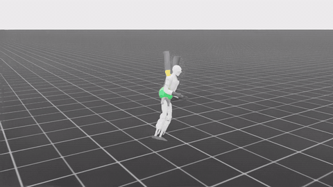

# Jet pack variant: how it was built (Nov 8-9, 2026)

Two gimballed jet boosters on the R1's back ("Pacific Rim" style). Demo: [media/jet_booster_demo.mp4](../media/jet_booster_demo.mp4)
(policy `checkpoints/jet/model_1499.pt`): standing take-off, 7-waypoint tour, 1.3 cm hold error, every waypoint reached.

## Design
- **Boosters**: simulated as one global force + torque on `waist_yaw_link` (torque = (nozzle - CoM) x F); casings and
  flames are visual markers only. Total thrust-to-weight 2.0 (284 N each), 2-axis gimbal +-25 deg, first-order lags
  (throttle 80 ms spool-up, gimbal 40 ms servo).
- **Mount**: at shoulder-blade height `(-0.10, +-0.12, 0.30)` in the torso frame (v2, the runs below; v3 widens
  it to `+-0.20`, see "Open issue"), with the neutral thrust axis canted
  ~13.5 deg so zero gimbal thrusts straight through the whole-body CoM (which sits near the hips). The robot hovers
  leaning forward, like a real jetpack pilot.
- **Actions (6)**: throttle L/R, gimbal pitch L/R, gimbal roll L/R. The body is held in its default pose by PD
  (a `-WholeBody-v0` variant adds 24 joint offsets; not trained).
- **Observations (77)**: body lin/ang velocity, projected gravity, goal in body frame, height, jet state (throttles,
  gimbals), joint pos/vel, last action.
- **Rewards**: coarse + fine distance-to-goal, progress toward the goal (m/s, clipped), uprightness about the thrust
  axis, lin/ang velocity, action rate, throttle cost, joint deviation, `action_bound` (penalise raw actions outside
  [-1, 1]), one-off termination penalty.
- **PPO** (RSL-RL 5): 4096 envs, 24 steps/env, MLP 256-128-64 ELU, obs normalisation, init std 0.6, entropy 0.005,
  adaptive LR 5e-4 (KL 0.01), gamma 0.99, lambda 0.95. 200 Hz physics, 50 Hz policy. ~1 h per 1200 iterations on an L40S.
- **Curriculum**: stage 1 learns to fly; stage 2 (`-Smooth-v0`) resumes with entropy 0 and heavier upright /
  ang-vel / action-rate / yaw-rate penalties.

## What happened, in order
| run | change | result |
|---|---|---|
| 1 | first version | learned to stand still: termination and effort penalties outweighed the goal reward |
| 2-5 | + progress reward, softer penalties | **flies** (0.3 m from goal) but bang-bang: 95 % of actions saturated, policy std grew to 11, spins at **6.2 rad/s** in yaw |
| 6 | stage 2 fine-tune with std reset + heavy penalties | no fix |
| 7 | entropy 0 from scratch | std collapsed to 0.08, never learned to fly |
| 8 | + `action_bound` penalty, entropy 0.005 | saturation 95 % -> 13 %, but still spins at 6.3 rad/s |
| 9 | stage 2 + yaw-rate penalty | spin only 6.3 -> 5.6 rad/s: the spin wasn't a reward problem |
| **10** | **booster mount moved up + canted through the CoM** | flies by iteration 300, spin **0.75 rad/s**, 1-2 % saturation |
| **11** | stage 2 smooth from run 10 | 0 falls, spin halved again (0.48 rad/s) |

**Root cause of the spin**: with the original mount (0.22 m above / 0.18 m behind the whole-body CoM), pointing the
thrust through the CoM needed 38 deg of gimbal against a 25 deg limit, so no static hover existed. Every policy
discovered that spinning averages the off-centre torque out. Fixing the geometry did what no reward change could.

## Final numbers (noise-free policy, 256 robots, 10 s of random goals; distance includes transit between goals)
| policy | dist to goal | falls | yaw rate | pitch rate | roll rate | saturated actions |
|---|---|---|---|---|---|---|
| run 5 (old mount) | 0.30 m | 1 | 6.2 rad/s | - | - | 95 % |
| run 10, iter 500 | 0.29 m | 0 | 0.79 | 0.47 | 1.23 | 2 % |
| run 10, final (1199) | 0.27 m | 2 | 1.05 | 0.59 | 1.47 | 3 % |
| **run 11 smooth (1499)** | 0.29 m | **0** | **0.48** | 0.45 | 1.47 | 3 % |

Waypoint tour (`scripts/demo.py`, 256 robots, standing take-off, 7 waypoints, 4 s each): **0 crashes, 100 % of
waypoints reached, hold error 1.3 cm mean / 2.1 cm p95**, mean tilt 28 deg (it flies leaning forward), yaw rate
while holding 0.29 rad/s.

## Open issue / next steps
- Roll wobble (~1.5 rad/s) is unchanged by stage 2. Suspected cause: roll authority comes mostly from differential
  throttle with the boosters only 0.24 m apart. Next: widen the spacing to ~0.40 m (about 1.7x the roll torque) and
  retrain stage 1 + 2, or try a roll-specific penalty, or the whole-body variant so arms/legs help balance.
- **2026-11-23: v3 mount, 0.40 m apart (`+-0.20`), in the config now, not trained yet.** The cant through the CoM is
  unchanged (the mounts moved sideways only). Compare roll rate against run 11 (1.47 rad/s) with `scripts/eval.py`.
  `checkpoints/jet/` still holds the v2 policies; replay them with the old mount for a faithful comparison.

## Training clips
`media/training_clips/`: `jet_v1_mount_spinning.mp4` (run 5, the spinning bang-bang policy), `jet_iter0.mp4`,
`jet_iter300_first_flight.mp4`, `jet_iter1100.mp4` (run 10), plus Iron Man stage-1 clips.
Per-100-iteration curves: `notes/training_curves/jet_*.txt`.

## W&B (project `humanoid_fly`)
Run 5 `ypuanvk3`, run 10 `mrqt4lhu`, run 11 (stage 2) `vi4qv48l`.
